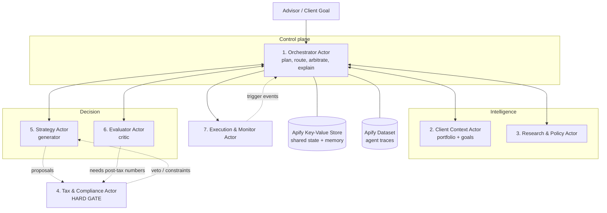

# WealthPilot

**An agentic multi-agent system for autonomous wealth management of High-Net-Worth Individuals (HNIs) in India, built as Apify Actors.**

> **Status:** Academic group project (BTech final year). Runs on **dummy data** by default. Live data collection (scraping / APIs) is designed in as an open extension point, not a requirement. See [Live Mode](#9-live-mode-optional-extension).
>
> **Disclaimer:** WealthPilot is a decision-support prototype. It is **not** investment advice. In production it is intended as an analyst-augmentation tool for SEBI-registered Investment Advisers (RIAs), wealth managers and family offices, who remain the regulated advisor.

---

## Table of Contents

1. [What this project does](#1-what-this-project-does)
2. [Why Apify Actors, and what makes them "agents" here](#2-why-apify-actors-and-what-makes-them-agents-here)
3. [Architecture at a glance](#3-architecture-at-a-glance)
4. [The 7 Actors (summary)](#4-the-7-actors-summary)
5. [Actor-by-actor documentation](#5-actor-by-actor-documentation)
6. [Shared state and data contracts](#6-shared-state-and-data-contracts)
7. [End-to-end worked scenario (with replanning and veto)](#7-end-to-end-worked-scenario)
8. [Dummy data](#8-dummy-data)
9. [Live Mode (optional extension)](#9-live-mode-optional-extension)
10. [Repository structure](#10-repository-structure)
11. [Setup and running](#11-setup-and-running)
12. [Design decisions and guardrails](#12-design-decisions-and-guardrails)
13. [Suggested team split](#13-suggested-team-split)
14. [Roadmap](#14-roadmap)

---

## 1. What this project does

HNIs in India hold fragmented portfolios: listed equity, mutual funds, PMS, AIFs, unlisted shares, real estate, gold and international assets via LRS. Good advice requires continuously combining four moving domains:

| Domain | Example of what changes |
|---|---|
| Market | Sector rotation, rate expectations, valuations |
| Regulation | SEBI circulars, RBI/LRS limits, Budget announcements |
| Tax | LTCG/STCG treatment, surcharge slabs, harvesting windows |
| Client | Liquidity needs, risk appetite, succession plans |

WealthPilot takes a goal such as *"Reduce my concentration in my own company's stock without a large tax hit"* and autonomously **plans** how to answer it, calls specialist agents, **resolves conflicts between them**, and returns ranked, explainable, compliance-checked options for the human advisor and client.

It is deliberately **not** a fixed pipeline. The order of agent calls, the number of strategy revisions, and which agents are invoked at all depend on what the agents discover along the way.

---

## 2. Why Apify Actors, and what makes them "agents" here

An **Apify Actor** is a serverless cloud program with a defined input schema, its own run lifecycle, and access to platform storage (key-value stores, datasets). Actors can be started programmatically, can call other Actors, and have a large Store of ready-made scrapers and tools.

An Actor by itself is just a container for code. **It is the code we put inside it that makes it an agent.** Every WealthPilot Actor contains an LLM-driven reasoning loop:

```
          ┌───────────────────────────────────────────────┐
          │                                               │
 GOAL ──► PLAN ──► ACT (call a tool) ──► OBSERVE ──► REFLECT
          ▲                                               │
          │          (goal met? confident? budget left?)  │
          └────────────── REPLAN if not ◄─────────────────┘
                                   │
                                   ▼
                     structured RESULT + reasoning trace
```

An Actor qualifies as an agent in this project only if it satisfies all of:

| Criterion | What it means in code |
|---|---|
| **Plans** | The LLM produces a step list for *this* input, not a hardcoded sequence |
| **Uses tools** | It chooses which tool to call and with what arguments (data readers, calculators, retrieval, other Actors) |
| **Observes and replans** | Tool failures or surprising results change its next step |
| **Bounded** | Hard limits on steps, tokens and revision rounds to prevent runaway loops |
| **Traceable** | Every plan/act/observe step is written to a trace dataset for explainability |

Suggested implementation: Python Actors using the Apify SDK, with LangGraph (or a plain loop) for the reasoning cycle inside each Actor. Any LLM provider works; the key is read from an Actor secret.

---

## 3. Architecture at a glance



**Key idea:** the Orchestrator is the only Actor that decides *who runs next*. Other Actors never call each other directly (except Tax acting as a gate on proposals, mediated through the Orchestrator). This keeps the system debuggable and the reasoning traceable.

---

## 4. The 7 Actors (summary)

We reduced the earlier 8-agent design to **7 Actors** by merging the Aggregator and Client Profile agents into a single *Client Context* Actor (both exist to build one thing: the current state of the client).

| # | Actor | One-line role | Reasoning style | Can block others? |
|---|---|---|---|---|
| 1 | `wp-orchestrator` | Plans the task graph, routes work, arbitrates conflicts, writes the client explanation | Planner / supervisor | No (but final arbiter) |
| 2 | `wp-client-context` | Builds a unified, reconciled picture of holdings **and** goals/risk profile | Data reconciliation + profiling | No |
| 3 | `wp-research-policy` | Finds market and regulatory developments relevant to *this* client's exposure | Exposure-driven investigation | No |
| 4 | `wp-tax-compliance` | Computes tax impact and checks suitability; can veto proposals | Constraint reasoning | **Yes (hard gate)** |
| 5 | `wp-strategy` | Generates multiple candidate portfolio strategies | Generator | No |
| 6 | `wp-evaluator` | Independently scores and ranks the candidates | Critic / multi-criteria judge | No |
| 7 | `wp-execution-monitor` | Simulates approved execution and watches for drift or trigger events | Sequencer + watcher | No |

Why not fewer? Merging Strategy and Evaluator would remove the generator/critic separation (our clearest demonstration of independent judgment). Merging Tax into Strategy would remove the veto, which is where our most important agent conflict happens.

---

## 5. Actor-by-actor documentation

### 5.1 `wp-orchestrator`: the brain

**Role:** Turns a human goal into a plan, runs the other Actors, and decides what to do when their outputs conflict or change the picture.

**Why it is a separate Actor:** It is the only component with a view of the whole problem. Planning and arbitration must not live inside a specialist, or the specialist becomes biased toward its own domain.

**Responsibilities**
- Decompose the goal into a task graph (for example: *need holdings → need tax impact → need candidates → rank*).
- Decide which Actors to invoke and in what order, per request.
- Detect when new information invalidates the plan (e.g., Tax discovers a harvesting window) and **replan**.
- Arbitrate conflicts (Tax says the sale is costly, Strategy says concentration risk is severe). Records the decision and the reasoning.
- Enforce loop limits (max 3 strategy revision rounds, then escalate to a human advisor).
- Produce the final client-facing explanation: what was considered, what was rejected and why, tax impact, risks.

**Tools it uses:** `Actor.call()` for every other Actor, key-value store read/write, trace dataset writer, LLM planner.

**Input (example)**
```json
{
  "clientId": "CLIENT_001",
  "goal": "Reduce concentration in my own company stock tax-efficiently",
  "mode": "dummy",
  "maxRevisionRounds": 3
}
```

**Output:** `final_report` (ranked options + explanation), `task_graph` (with all replans), `arbitration_log`.

**Agentic behavior to demonstrate:** at least one replan caused by another Actor's output, and at least one logged arbitration decision.

---

### 5.2 `wp-client-context`: who the client is and what they own

**Role:** Produces a single reconciled `ClientContext` object containing (a) the full portfolio and (b) the client's goals, risk profile and constraints.

**Why one Actor for both:** Portfolio state and client objectives are the two inputs every downstream agent needs. Keeping them together means one source of truth and one place where inconsistencies (e.g., stated "low risk" but 38% in one stock) are detected.

**Responsibilities**
- **Portfolio side:** ingest holdings from multiple sources and formats (broker CSV, PMS/AIF statement text, manual entries for unlisted shares and real estate, LRS holdings), normalize units and currencies, deduplicate, and compute asset-class and issuer-level exposure.
- **Plans around gaps:** if a source is missing or a value looks wrong (for example an AIF NAV that is stale), it decides whether to request clarification, use a fallback, or flag low confidence.
- **Profile side:** maintain risk appetite, multiple concurrent goals (liquidity needs, wealth preservation, succession, philanthropy), time horizons, family and estate notes.
- **Consistency check:** flag mismatches between stated profile and actual portfolio behavior.
- **Memory:** persist profile changes and the *reason* for past decisions or rejected suggestions.

**Tools it uses:** file/format parsers, currency converter (static table in dummy mode), key-value store (client memory), LLM extractor for unstructured statements.

**Input:** `clientId`, `sources[]` (paths or store keys), optional `refreshProfile`.

**Output:** `ClientContext` JSON:
```json
{
  "clientId": "CLIENT_001",
  "netWorthINR": 120000000,
  "holdings": [ { "assetClass": "listed_equity", "issuer": "PROMOTER_CO", "valueINR": 45600000, "pctOfNetWorth": 38.0 } ],
  "exposure": { "bySector": {}, "byAssetClass": {}, "topIssuerPct": 38.0 },
  "goals": [ { "type": "liquidity", "amountINR": 20000000, "horizonYears": 2 } ],
  "riskProfile": "moderate",
  "dataQualityFlags": ["AIF_X NAV is 45 days old"],
  "profileConsistencyFlags": ["Stated moderate risk vs 38% single-issuer exposure"]
}
```

---

### 5.3 `wp-research-policy`: what in the world matters to *this* client

**Role:** Investigates market, macro and regulatory developments, prioritized by the client's actual exposure.

**Why it is a separate Actor:** It deals with external, fast-changing, unstructured information, which is a different kind of problem from the client's internal state and from rule application.

**Responsibilities**
- Read `ClientContext.exposure` and **decide what is worth investigating** (e.g., 30% in NBFCs leads to prioritizing RBI rate and NBFC regulation news; 8% in US equities via LRS leads to checking LRS/TCS rule changes).
- Search a knowledge source, extract relevant facts, rate relevance and confidence.
- Cover: sector and market outlook, interest-rate/macro view, SEBI circulars, RBI/LRS policy, Budget and tax-policy announcements.
- Produce short, sourced briefs rather than raw news.
- Hand regulatory/tax-relevant findings to the Orchestrator with a flag so Tax & Compliance can be re-consulted.

**Tools it uses:** retrieval over a local policy/market knowledge base (dummy mode); in live mode, Apify Store scrapers/crawlers as tools (see [Live Mode](#9-live-mode-optional-extension)); LLM summarizer.

**Input:** `exposure`, `goalSummary`, `lookbackDays`, `maxTopics`.

**Output:** list of `ResearchFinding` objects:
```json
{
  "topic": "Surcharge / capital gains rule change",
  "relevance": 0.91,
  "confidence": 0.8,
  "affects": ["tax", "strategy"],
  "summary": "…",
  "sources": ["kb://policy/budget_summary_example"]
}
```

**Agentic behavior to demonstrate:** two clients with different exposures cause the Actor to investigate *different* topics from the same knowledge base.

---

### 5.4 `wp-tax-compliance`: the hard gate

**Role:** Calculates the tax consequences of any proposed action and checks it against suitability and regulatory constraints. Has authority to **approve, approve-with-conditions, or veto**.

**Why it is a separate Actor:** It is the main source of *legitimate conflict*. Its job is to say "no" or "not like that", and that must be independent of the Actor that is proposing.

**Responsibilities**
- **Tax impact:** LTCG/STCG by asset class and holding period, surcharge/cess effects, set-off and carry-forward, tax-loss harvesting opportunities, regime/structure considerations (individual vs HUF vs trust), gift and succession implications.
- **Plans multi-step computations:** for a large sale it can decide to split across financial years, pair with loss-making lots, or suggest staged exits, then re-compute.
- **Suitability and compliance:** check each proposal against the client's risk profile, concentration limits, product eligibility (for example, AIF minimum ticket, accredited-investor style conditions), and LRS limits.
- **Veto with a reason:** return machine-readable constraints that Strategy can use to regenerate (for example, "max sale this FY ₹X to stay under threshold Y").
- **Hard gate:** *no recommendation reaches the final report without a Tax & Compliance verdict.*

**Tools it uses:** deterministic tax calculator functions (pure code, unit-tested), versioned rule pack (`rules/tax_rules_*.json`), retrieval over compliance guidelines, LLM for reasoning about which calculations to run.

> **Important design choice:** the LLM *decides what to compute*; the arithmetic itself is done by **deterministic, tested code**. LLMs must not do tax maths directly. Rules live in a versioned config file, not in prompts, because rates and thresholds change with each Budget. Values in the dummy rule pack are **illustrative and must be verified against current law** before any real use.

**Input:** `proposal` (list of actions), `ClientContext`, `researchFindings[]`, `financialYear`.

**Output:**
```json
{
  "verdict": "APPROVE_WITH_CONDITIONS",
  "estimatedTaxINR": 2450000,
  "harvestingOpportunities": [ { "lot": "…", "lossINR": 310000 } ],
  "constraints": [ "Limit sale of PROMOTER_CO to ₹2.0 Cr in FY; remainder next FY" ],
  "complianceFlags": [],
  "reasoning": "…"
}
```

---

### 5.5 `wp-strategy`: the generator

**Role:** Proposes **multiple** candidate portfolio strategies that satisfy the client's goals, incorporating alternative assets and concentration/correlation risk.

**Why it is a separate Actor:** Creative generation and critical judgment are different tasks. Keeping them in separate Actors prevents a strategy from grading its own homework.

**Responsibilities**
- Use the client's objective (from `ClientContext`) as its optimization target and research findings as context.
- Generate 3 to 5 distinct candidates (for example *aggressive diversification now*, *staged exit over 2 FYs*, *hedge-and-hold*, *hybrid with alternatives*).
- Consider alternative assets (PMS, AIF categories, REITs/InvITs, structured products, international via LRS) *when they fit the profile*.
- Analyze concentration (single issuer, sector, promoter-linked), correlation across holdings and simple stress scenarios (rate hike, INR depreciation, equity drawdown).
- On receiving a **veto or constraints** from Tax & Compliance, **regenerate** within those constraints instead of just trimming the same plan.

**Tools it uses:** portfolio math utilities (weights, correlation from dummy return series, scenario shocks), product catalog of dummy alternative investments, LLM generator.

**Input:** `ClientContext`, `researchFindings[]`, optional `constraints[]` (from a previous veto), `numCandidates`.

**Output:** list of `CandidateStrategy`:
```json
{
  "id": "S2",
  "name": "Staged exit over two financial years",
  "actions": [ { "type": "SELL", "asset": "PROMOTER_CO", "amountINR": 20000000, "when": "FY26-27" } ],
  "targetAllocation": {},
  "expectedRiskMetrics": { "topIssuerPctAfter": 24.0, "stressLoss": -0.11 },
  "rationale": "…"
}
```

---

### 5.6 `wp-evaluator`: the critic

**Role:** Independently scores and ranks candidate strategies against explicit, multi-criteria objectives *for this client*.

**Why it is a separate Actor:** Independent judgment is the core of the generator/critic pattern. The Evaluator has not seen how a candidate was produced, only what it does.

**Responsibilities**
- Evaluate each candidate on: post-tax return estimate (using Tax & Compliance outputs), liquidity vs. client goals, concentration reduction, correlation with remaining holdings, downside under stress scenarios, regulatory/compliance risk, and execution complexity.
- **Weights come from the client's goals**, not from a generic scorecard (a client needing ₹2 Cr liquidity in 2 years weights liquidity heavily).
- Produce a ranked list with **per-criterion scores and a written justification**, not a single opaque number.
- Reject candidates that fail minimum thresholds, and say why.
- Can request additional data (for example ask Tax for post-tax numbers on a candidate that does not yet have them) before ranking.

**Tools it uses:** scoring functions (deterministic), `Actor.call()` to Tax & Compliance for missing post-tax data via the Orchestrator, LLM for weight derivation and justification.

**Input:** `candidates[]`, `ClientContext`, `taxVerdicts[]`.

**Output:**
```json
{
  "ranking": [
    { "id": "S2", "rank": 1, "totalScore": 0.82,
      "criteria": { "postTaxReturn": 0.74, "liquidity": 0.9, "concentration": 0.85, "stress": 0.8 },
      "justification": "…" }
  ],
  "rejected": [ { "id": "S1", "reason": "Tax cost exceeds client's stated tolerance" } ]
}
```

---

### 5.7 `wp-execution-monitor`: make it real, then watch it

**Role:** After human approval, sequences the plan into executable steps (simulated in this project), handles partial failures, then continuously monitors for drift and trigger events.

**Why it is a separate Actor:** It is the only long-running, *event-driven* component. Everything else is request/response. It is also the only one that acts on the world after the decision is made.

**Responsibilities**
- **Execution (simulated):** order the trades/transfers sensibly (for example liquidity before purchase, settlement timing), submit to a mock broker, handle partial fills/closed-subscription cases by replanning the remaining steps.
- **Monitoring:** compare the live (dummy) portfolio against the approved plan; detect drift beyond tolerance; watch for **trigger events** (rating downgrade, promoter pledge increase, policy change flagged by Research).
- **Decide when to re-engage:** it autonomously judges whether an event is material enough to wake the Orchestrator, to avoid alert fatigue.
- **Human-in-the-loop:** never executes without an explicit `approved: true` input from the advisor.

**Tools it uses:** mock broker API (local simulator), event feed (dummy JSON stream), Apify schedules to run periodic checks, key-value store for plan state.

**Input:** `approvedPlan`, `approved` (must be true), `monitoringConfig`.

**Output:** `executionLog`, `driftReport`, and (when needed) a `reengageRequest` sent to the Orchestrator.

---

## 6. Shared state and data contracts

All Actors communicate through **typed JSON** and a small set of Apify storages. Agree on these schemas first as a team; everything else can then be built in parallel.

| Storage | Type | Name | Purpose |
|---|---|---|---|
| Client state and memory | Named Key-Value Store | `wealthpilot-state` | `client/{id}/context`, `client/{id}/memory`, `run/{runId}/task_graph`, `run/{runId}/candidates`, `run/{runId}/verdicts` |
| Agent traces | Named Dataset | `wealthpilot-trace` | One row per plan/act/observe step: `actor`, `step`, `thought`, `tool`, `args`, `result_summary`, `timestamp` |
| Final reports | Named Dataset | `wealthpilot-reports` | Ranked options and the explanation per run |

**Memory layers**

| Layer | Contents | Written by |
|---|---|---|
| Client memory | Profile, goals, past decisions and why rejected | Client Context |
| Portfolio state | Holdings, drift history, execution history | Client Context, Execution & Monitor |
| Episodic / learning | What research predicted vs what happened | Research & Policy, Evaluator |

Use **named** storages (not the default per-run ones) so memory persists across runs.

**Contract rules**
1. Every Actor validates its input against its `INPUT_SCHEMA.json`.
2. Every output includes `confidence` and `reasoningSummary`.
3. Every tool call is logged to the trace dataset.
4. Schemas live in `/schemas` and are shared by all Actors.

---

## 7. End-to-end worked scenario

**Goal:** *"CLIENT_001 holds 38% of net worth in his own company (PROMOTER_CO). Reduce concentration tax-efficiently; he needs ₹2 Cr of liquidity within 2 years."*

| Step | Actor | What happens | Agentic element |
|---|---|---|---|
| 1 | Orchestrator | Builds initial task graph: *context → research → strategy → tax gate → evaluate* | Planning |
| 2 | Client Context | Reconciles 5 sources; flags a stale AIF NAV and the profile-vs-exposure mismatch | Gap handling |
| 3 | Research & Policy | Because top exposure is a single mid-cap in one sector, investigates sector outlook and capital-gains policy | Exposure-driven planning |
| 4 | Strategy | Proposes S1 (sell 60% now), S2 (staged over 2 FYs), S3 (partial sale + hedge), S4 (sale + AIF/REIT rotation) | Generation |
| 5 | Tax & Compliance | **Vetoes S1**: selling 60% in one FY triggers a very large tax bill and a higher surcharge band. Returns constraint: *"max ₹2.0 Cr sale this FY"* | **Conflict + veto** |
| 6 | Orchestrator | **Replans**: re-invokes Strategy with the constraint (rather than continuing the old graph) | **Replanning** |
| 7 | Tax & Compliance | While re-checking, also finds loss-making lots that can offset gains and reports a harvesting opportunity | Opportunistic discovery |
| 8 | Orchestrator | **Replans again**: sends the harvesting opportunity to Strategy, producing revised S2' and S4' | Replanning on new info |
| 9 | Evaluator | Ranks S2', S4', S3 on post-tax return, liquidity, concentration, stress. Rejects S1 | Independent judgment |
| 10 | Orchestrator | **Arbitrates**: Risk-minded ranking favors S4', but Evaluator marks its AIF lock-in as conflicting with the 2-year liquidity goal; picks S2' as primary, S4' as alternative, logs why | **Arbitration** |
| 11 | Orchestrator | Produces the explanation: options, tax impact, what was rejected and why | Explainability |
| 12 | Execution & Monitor | After advisor approval: simulates staged trades, then monitors for a (dummy) promoter-pledge increase and re-engages | Post-decision autonomy |

This single trace doubles as the demo script and the architecture walkthrough: it shows planning, tool use, a veto, **two** replans, an arbitration, and post-decision monitoring.

---

## 8. Dummy data

Since the project runs on dummy data, everything below lives in `/data` and is loaded through the same tool interface that live data would use (see [Live Mode](#9-live-mode-optional-extension)).

| File | Contents |
|---|---|
| `data/clients/client_001.json` | Persona: promoter-entrepreneur, ₹12 Cr net worth, moderate risk, 38% in PROMOTER_CO, ₹2 Cr liquidity goal in 2 years, succession note |
| `data/clients/client_002.json` | Contrast persona: salaried senior executive, heavy NBFC/financials exposure, LRS holdings (to show Research prioritizes differently) |
| `data/portfolios/*.csv, *.txt` | Mixed-format holdings: broker CSV, PMS/AIF statement text, manual entries for unlisted shares and real estate |
| `data/market/returns.csv` | Synthetic return series for correlation and stress testing |
| `data/kb/policy/*.md` | Short synthetic policy and circular summaries |
| `data/kb/market/*.md` | Synthetic sector and macro briefs |
| `data/products/alternatives.json` | Dummy PMS/AIF/REIT/InvIT catalog with lock-ins and minimum tickets |
| `data/events/events.json` | Scripted trigger events for the monitor (rating downgrade, pledge increase, policy change) |
| `rules/tax_rules_fy_demo.json` | **Illustrative** tax rates, thresholds and surcharge bands (versioned, verify before real use) |

**Tip:** deliberately design the dummy data so the key conflicts *occur naturally* (large tax cost on a concentration sale, a harvestable loss lot, an AIF lock-in vs liquidity goal). This makes the demo reproducible.

---

## 9. Live Mode (optional extension)

Live data is **not required** for this project, but the architecture keeps it a drop-in change.

**How it works:** every data-reading capability is a *tool* with a stable interface (for example `get_holdings(source)`, `search_policy(query)`, `get_market_brief(sector)`). In dummy mode these read from `/data`. In live mode the same tools are backed by real sources. Agent code does not change.

Switch with an environment variable:

```
WEALTHPILOT_MODE=dummy   # default
WEALTHPILOT_MODE=live
```

**Possible live sources for each Actor**

| Actor | Dummy source | Possible live source |
|---|---|---|
| Client Context | `/data/portfolios` | Broker/aggregator APIs (e.g., account-aggregator style consent flows), user-uploaded statements |
| Research & Policy | `/data/kb` | Apify Store crawlers/search scrapers pointed at SEBI, RBI, Budget and reputable financial news pages; official RSS/APIs where available |
| Tax & Compliance | `rules/*.json` | Rule pack updated from official notifications (keep human-reviewed) |
| Strategy | `data/products` | Fund factsheets, product catalogs |
| Execution & Monitor | Mock broker + `events.json` | Broker sandbox APIs, price/event feeds |

**Rules for live mode:** respect each site's terms of service and robots.txt, prefer official APIs and feeds, never scrape or store personal financial data without consent, and keep a human review step for any rule or regulatory content that feeds the Tax & Compliance Actor.

---

## 10. Repository structure

```
wealthpilot/
├── README.md
├── schemas/                     # shared JSON schemas (data contracts)
├── data/                        # dummy data (see section 8)
├── rules/                       # versioned tax / compliance rule packs
├── shared/                      # shared code: trace logger, storage helpers, LLM client, tool registry
├── actors/
│   ├── wp-orchestrator/
│   │   ├── .actor/actor.json
│   │   ├── .actor/INPUT_SCHEMA.json
│   │   └── src/main.py
│   ├── wp-client-context/
│   ├── wp-research-policy/
│   ├── wp-tax-compliance/
│   ├── wp-strategy/
│   ├── wp-evaluator/
│   └── wp-execution-monitor/
├── tests/
│   ├── test_tax_calculator.py   # deterministic maths must be unit-tested
│   ├── test_contracts.py        # input/output schema validation
│   └── test_scenario_001.py     # end-to-end scenario from section 7
└── docs/
    └── trace_examples/          # saved traces for the demo
```

---

## 11. Setup and running

**Prerequisites:** Apify account, Apify CLI, Python 3.11+, an LLM API key.

```bash
# 1. Install the Apify CLI
npm install -g apify-cli
apify login

# 2. Clone and install shared dependencies
git clone <repo-url> wealthpilot && cd wealthpilot
pip install -r requirements.txt

# 3. Configure secrets (locally via .env, on Apify via Actor environment variables / secrets)
cp .env.example .env
# set: LLM_API_KEY, WEALTHPILOT_MODE=dummy

# 4. Run a single Actor locally (example)
cd actors/wp-tax-compliance
apify run --input-file ../../data/sample_inputs/tax_check.json

# 5. Run the full scenario locally via the Orchestrator
cd ../wp-orchestrator
apify run --input-file ../../data/sample_inputs/orchestrator_client_001.json

# 6. Deploy all Actors to the Apify platform
apify push    # run inside each actor folder
```

**Orchestrator calling other Actors (Python SDK sketch)**

```python
from apify import Actor

async def call_agent(actor_name: str, payload: dict) -> dict:
    run = await Actor.call(actor_name, run_input=payload)
    store = await Actor.open_key_value_store(id=run.default_key_value_store_id)
    return await store.get_value("OUTPUT")
```

**Viewing the reasoning:** open the `wealthpilot-trace` dataset in the Apify console. Each row is one plan/act/observe step, which is the evidence of agentic behavior for evaluators.

---

## 12. Design decisions and guardrails

| Decision | Reason |
|---|---|
| **Orchestrator is the only router** | Keeps control flow and the audit trail in one place |
| **Tax & Compliance is a hard gate** | Nothing reaches a client unchecked; also clarifies responsibility |
| **LLM plans, code computes** | Tax and portfolio maths must be deterministic and unit-tested |
| **Generator and critic separated** | Independent judgment; easy to explain and demo |
| **Hard loop limits** | Max steps per Actor, max 3 strategy revision rounds, then escalate to a human |
| **Human approval before execution** | Execution Actor refuses to run without `approved: true` |
| **Everything is traced** | Explainability and debugging; the trace is the main demo artifact |
| **Rules in versioned config** | Tax law changes yearly; avoids baking numbers into prompts |
| **Dummy/live behind one tool interface** | Switching modes requires no agent code changes |
| **Cost control** | Cap tokens per run; cache research results; use smaller models for routine steps |

**Known limitations (state these honestly in the report)**
- Dummy data means results demonstrate *behavior*, not real investment quality.
- LLM outputs can be inconsistent, so structured output validation and retries are required.
- Tax rules are illustrative and not a substitute for a qualified professional.
- Production use would require RIA oversight, data-protection compliance (including India's DPDP Act), consent management, and security review.

---

## 13. Suggested team split

| Member | Owns | Notes |
|---|---|---|
| A | `wp-orchestrator` + `shared/` + trace logging | Most complex; planning, replanning, arbitration |
| B | `wp-client-context` + dummy portfolio/client data | Parsers and memory |
| C | `wp-tax-compliance` + `rules/` + tax unit tests | Deterministic calculators plus veto logic |
| D | `wp-strategy` + `wp-evaluator` | Generator/critic pair; share a scoring contract |
| E | `wp-research-policy` + `wp-execution-monitor` + KB and event data | Retrieval, mock broker, monitoring |

**First week:** agree on `/schemas` and the shared tool interface. Everything else can then proceed in parallel.

---

## 14. Roadmap

- [ ] **Phase 1:** schemas, shared utilities, dummy data
- [ ] **Phase 2:** each Actor working standalone with its own tests
- [ ] **Phase 3:** Orchestrator integration; scenario 001 end-to-end including veto, replanning and arbitration
- [ ] **Phase 4:** execution simulation and monitoring with scripted events
- [ ] **Phase 5:** trace visualization and a simple advisor-facing UI
- [ ] **Phase 6 (optional):** live mode for Research & Policy using Apify Store crawlers
- [ ] **Phase 7 (optional):** evaluation of agent decisions versus a human-advisor baseline

---

*WealthPilot is an academic prototype built for demonstration. It does not provide investment, tax or legal advice.*
